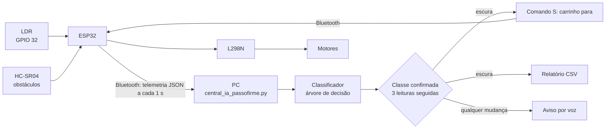

# Passo Firme: robô assistente para iluminação segura em espaços públicos

> Projeto da Global Solution, tema **CitizenTech**.
> Evolução de um carrinho robô controlado por Bluetooth (MakerLab) com **sensor LDR** e **Inteligência Artificial**.

## Vídeo demonstrativo

**[https://youtu.be/vzqqeIQnQ58]**

---

## 1. Proposta

### Problema (CitizenTech)
Calçadas, corredores, praças e pontos de ônibus mal iluminados são um risco real para **idosos e pessoas com baixa visão**: a falta de luz esconde degraus, buracos e desníveis e aumenta o risco de quedas. Além disso, o poder público raramente sabe **onde** estão esses trechos escuros, porque o problema só é percebido depois que alguém se machuca.

### Solução
O **Passo Firme** é um carrinho robô que percorre o ambiente, **mede a luminosidade com um sensor LDR** e usa IA para decidir o que fazer:

1. **Classifica** a iluminação do trecho em `clara`, `penumbra` ou `escura`.
2. **Decide sozinho**: ao entrar em um trecho `escuro`, o carrinho **para automaticamente**, sem depender de comando manual.
3. **Avisa por voz** o usuário sobre a condição do local.
4. **Registra** cada ponto escuro (data, hora e leitura) em um **relatório CSV** que pode apoiar a manutenção e a gestão da iluminação pública.

Como reforço de segurança, o ultrassônico HC-SR04 detecta obstáculos à frente e faz uma **parada de emergência**, o que também ajuda no uso por pessoas cegas.

### Onde a IA entra
| Etapa | Técnica |
|---|---|
| Classificação da iluminação | **Machine learning**: árvore de decisão (scikit-learn), treinada com leituras reais do LDR coletadas por nós |
| Entradas do modelo | Luminosidade e **delta** (variação em relação às leituras recentes, que indica a tendência de escurecer ou clarear) |
| Decisão autônoma | O PC comanda a parada do carrinho quando a classe `escura` é confirmada |
| Resposta ao usuário | Síntese de voz (`pyttsx3`) e, **opcionalmente**, um LLM que gera o aviso falado |

> **Observação:** o modelo roda **no PC** (não é TinyML dentro do ESP32). O uso do LLM é **opcional** (precisa de chave de API); sem ele, o sistema usa avisos pré-definidos e todas as demais funções continuam iguais.

---

## 2. Componentes utilizados

| Componente | Função no projeto |
|---|---|
| **ESP32 (DevKit)** | Microcontrolador. Lê os sensores, aciona os motores e conversa com o PC por **Bluetooth clássico** (nome `PassoFirme_Bot`) |
| **Driver L298N (ponte H)** | Aciona os motores DC do carrinho (frente, trás, esquerda, direita e parada) |
| **Motores DC com rodas** | Movimentação do carrinho |
| **Sensor ultrassônico HC-SR04** | Detecta obstáculos à frente (parada de emergência a menos de 25 cm) |
| **LDR (sensor de luminosidade)** | **Sensor adicional do projeto.** Mede a luz do ambiente. Ligado ao GPIO 32 e ao GND, usando o resistor *pull-up* interno do ESP32 |
| **Powerbank** | Fonte de alimentação principal do carrinho |
| **Pilhas** | Fonte de alimentação alternativa (testada na troca de fonte) |
| **PC com Bluetooth** | Executa a IA (classificador, voz, relatório) e permite dirigir o carrinho pelo teclado |

### Mapeamento de pinos

| Dispositivo | Pino do ESP32 |
|---|---|
| L298N IN1 | GPIO 13 |
| L298N IN2 | GPIO 12 |
| L298N IN3 | GPIO 14 |
| L298N IN4 | GPIO 27 |
| HC-SR04 TRIG | GPIO 5 |
| HC-SR04 ECHO | GPIO 18 |
| LDR | GPIO 32 e GND (sem resistor externo) |

> Garanta que o **GND do ESP32 e o GND do L298N estejam conectados**.

### Esquema de ligação
**[ADICIONAR AQUI A FOTO OU O DIAGRAMA DAS LIGAÇÕES, por exemplo `docs/esquema.png`]**

---

## 3. Instalação e execução

### 3.1 Pré-requisitos
- Windows com Bluetooth (o controle por teclado usa `msvcrt`, exclusivo do Windows)
- Python 3.9 ou superior
- Arduino IDE com o pacote de placas **ESP32** instalado

### 3.2 Gravar o firmware no ESP32
1. Abra o arquivo `passo_firme_v2/passo_firme_v2.ino` no Arduino IDE. (O Arduino IDE exige que o `.ino` esteja em uma pasta com o mesmo nome.)
2. Selecione a placa **ESP32 Dev Module** e a porta USB correta.
3. Clique em **Upload**.
4. Abra o Monitor Serial em **115200** e confirme a mensagem `Passo Firme v2 iniciado!`.

### 3.3 Instalar as bibliotecas Python
```bash
pip install pyserial pyttsx3 scikit-learn
```
Opcional, apenas para o aviso gerado por LLM:
```bash
pip install anthropic
```

### 3.4 Parear o Bluetooth
1. Ligue o carrinho (powerbank ou pilhas).
2. No Windows, abra **Configurações > Bluetooth e dispositivos > Adicionar dispositivo > Bluetooth**.
3. Selecione **`PassoFirme_Bot`** e conclua o pareamento (se pedir senha, normalmente é `1234` ou `0000`).
4. **Feche o app de celular** de controle, se estiver em uso: o Bluetooth clássico aceita uma conexão por vez.

### 3.5 Descobrir a porta COM
1. Vá em **Configurações > Bluetooth e dispositivos > Mais configurações de Bluetooth > aba Portas COM**.
2. Anote a porta de **Saída** associada ao `PassoFirme_Bot` (por exemplo, `COM5`).
3. Abra `central_ia_passofirme.py` e ajuste a linha:
   ```python
   PORTA = "COM5"   # troque pela sua porta
   ```

### 3.6 Coletar dados de treino
Execute os comandos a partir da pasta do repositório (os arquivos CSV são gravados nela). Cada comando grava 60 leituras no `dados.csv`:

```bash
python central_ia_passofirme.py coletar clara      # sensor com luz boa
python central_ia_passofirme.py coletar penumbra   # luz fraca ou sensor parcialmente coberto
python central_ia_passofirme.py coletar escura     # sensor totalmente coberto
```

Dicas para uma boa coleta:
- Mantenha a condição **estável durante toda a coleta**.
- Use os rótulos exatamente como acima (sem espaços ou pontuação extras).
- Confira a separação entre as classes com o script auxiliar:
  ```bash
  python conferir_dados.py
  ```
  As faixas de `clara`, `penumbra` e `escura` **não devem se sobrepor**.

### 3.7 Treinar e rodar
O treinamento acontece automaticamente ao iniciar a execução, a partir do `dados.csv`:

```bash
python central_ia_passofirme.py rodar
```

Se tudo estiver certo, o terminal mostra algo como `Modelo treinado com ... amostras` e passa a exibir, a cada segundo, a leitura e a classe (`lum=... delta=... -> clara`).

**Controles (clique no terminal para ele ficar em foco):**

| Tecla | Ação |
|---|---|
| `W` ou seta para cima | Frente |
| `S` ou seta para baixo | Ré |
| `A` ou seta para a esquerda | Esquerda |
| `D` ou seta para a direita | Direita |
| `Espaço` | Parar |
| `Q` | Sair |

### 3.8 (Opcional) Aviso gerado por LLM
Defina a chave **na sessão do terminal** (nunca dentro do código nem no repositório):
```powershell
$env:ANTHROPIC_API_KEY="sua-chave-aqui"
python central_ia_passofirme.py rodar
```
Sem a chave, o sistema usa os avisos pré-definidos.

---

## 4. Integração entre os sensores e a IA

### 4.1 Fluxo geral



### 4.2 Passo a passo
1. **Leitura:** o ESP32 lê o LDR (média de 4 amostras) e o HC-SR04 a cada 100 ms. Como o LDR usa o *pull-up* interno, **quanto mais escuro, maior o valor lido**.
2. **Telemetria:** a cada 1 segundo o ESP32 envia um JSON pelo Bluetooth:
   ```json
   {"distancia_cm":21,"luminosidade":831,"status_luz":"ADEQUADA_SEGURO","status_via":"OBSTACULO_PROXIMO","heap":210000,"up_s":125}
   ```
   | Campo | Significado |
   |---|---|
   | `distancia_cm` | Distância do obstáculo à frente |
   | `luminosidade` | Leitura do LDR (0 a 4095) |
   | `status_luz` | Classificação simples feita no firmware (limiar de 1400) |
   | `status_via` | `LIVRE` ou `OBSTACULO_PROXIMO` (menos de 25 cm) |
   | `heap` e `up_s` | Diagnóstico: memória livre e tempo ligado |
3. **Classificação (PC):** o script calcula o `delta` (variação da luminosidade em relação às últimas leituras) e o classificador devolve `clara`, `penumbra` ou `escura`.
4. **Confirmação:** uma classe só é considerada válida após **3 classificações iguais seguidas**, o que evita alarmes falsos por uma leitura isolada.
5. **Decisão autônoma:** ao confirmar `escura`, o PC envia o comando `S` pelo Bluetooth e o carrinho **para sozinho**.
6. **Resposta:** o PC fala o aviso (LLM opcional ou texto padrão) e **registra o ponto escuro** no relatório.
7. **Relatório:** o arquivo `relatorio_pontos_escuros.csv` guarda `data_hora`, `luminosidade` e `classe` de cada ocorrência, como insumo para manutenção da iluminação pública.

### 4.3 Comandos aceitos pelo ESP32 (PC para carrinho)

| Comando | Ação |
|---|---|
| `F` | Frente |
| `B` | Ré |
| `L` | Esquerda |
| `R` | Direita |
| `S` | Parar |

### 4.4 Regras de segurança no firmware
- **Obstáculo à frente** (menos de 25 cm, confirmado em 2 leituras): parada de emergência e alerta enviado ao PC.
- **Bluetooth desconectado:** o carrinho para sozinho.
- O ESP32 só envia dados quando há um cliente conectado, para não travar o recebimento de comandos.

### 4.5 Dados de treino utilizados
Valores de luminosidade obtidos na nossa coleta (faixas bem separadas):

| Classe | Amostras | Mínimo | Máximo |
|---|---|---|---|
| `clara` | 120 | 0 | 40 |
| `penumbra` | 60 | 732 | 953 |
| `escura` | 56 | 1245 | 2576 |

Os dados completos estão em `dados.csv`. Os valores dependem do ambiente e da luz usada; **recoletar os dados** é recomendado se o local de uso mudar.

---

## 5. Testes e demonstração

| Cenário | Comportamento esperado |
|---|---|
| Ambiente claro | Classe `clara`, carrinho segue normalmente |
| Penumbra | Classe `penumbra`, aviso de pouca iluminação |
| Escuro total | Classe `escura`, carrinho para sozinho, aviso por voz e registro no relatório |
| Obstáculo à frente | Parada de emergência pelo ultrassônico |
| Bluetooth desconectado | Carrinho para por segurança |
| Troca de fonte (powerbank e pilhas) | Funcionamento mantido |


---

## 6. Estrutura do repositório

```
passo-firme-gs/
├── README.md
├── central_ia_passofirme.py        # IA no PC: coleta, treino, decisão, voz e relatório
├── conferir_dados.py               # confere as faixas de cada classe no dados.csv
├── dados.csv                       # dados de treino rotulados
├── relatorio_pontos_escuros.csv    # relatório gerado na execução
└── passo_firme_v2.ino              # firmware do ESP32
```

---

## 7. Limitações e melhorias futuras
- Com um único LDR, as classes ficam bem separadas por faixas de luminosidade; o ganho do aprendizado de máquina sobre limiares simples vem principalmente da tendência (`delta`) e do treino com dados reais.
- O modelo roda no PC. Uma evolução natural é **embarcar o modelo no ESP32 (TinyML)** e dispensar o computador.
- Combinar o LDR com o ultrassônico para decidir por voz o melhor caminho para pessoas cegas.
- Georreferenciar os pontos escuros (por exemplo, com GPS) para gerar mapas de manutenção.

---

## 8. Segurança do repositório
**Não** suba chaves de API para o repositório. Use apenas variáveis de ambiente.

## 9. Equipe
- **[David de Medeiros Pacheco Junior]** - RM [551462]
- **[Pedro Henrique Alves Guariente]** - RM [550301]
- **[Kaique Maia Reis Silva]** - RM [552112]
- **[Orlando Akio Morii Cardoso]** - RM [98067]


Curso/Disciplina: **[Project Maker Labs]**
